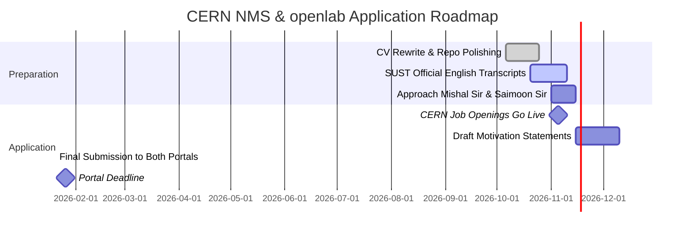

# CERN Application Strategy & Profile Diagnostic
**Applicant:** Ihfaz Ahmed Adib (SUST CSE)  
**Target Opportunities:** CERN Non-Member State Summer Student Programme (NMS-SSP) & CERN openlab Summer Student Programme  
**Cycle:** 2026–2027 (Applications open: November | Deadline: Late January)

---

## 1. Executive Summary: The Core Revelation

The initial premise was evaluating how much of an "outlier" Ihfaz's CV (`Ihfaz_Resume_Claude_Campus (1).pdf`) is from meeting **CERN Technical Studentship** requirements.

Through deep investigation, two major discoveries redefined the entire roadmap:
1. **Administrative Barrier (Hard Disqualification for Technical Studentship):** The *Technical Studentship (TS)* is legally restricted to nationals of CERN Member States and Associate Member States. Bangladesh is a Non-Member State (NMS). Unless dual nationality is held, direct TS applications are automatically rejected. The legitimate, fully funded entry points for Bangladeshi students are the **CERN Non-Member State Summer Student Programme (NMS-SSP)** and the **CERN openlab Summer Student Programme**.
2. **Hidden Competitive Goldmine:** Ihfaz's CV originally showcased NLP fine-tuning, prompt-injection red-teaming, Hyperledger Fabric, and FMCG business competitions—making it a heavy thematic outlier from CERN's scientific computing core. However, an unlisted repository on his GitHub—[`ihfaz297/cpu-scheduling-fairness-survey`](https://github.com/ihfaz297/cpu-scheduling-fairness-survey)—benchmarks CPU scheduling fairness across 10 authentic supercomputing traces (ANL-Intrepid, CEA-Curie) in Standard Workload Format (SWF). This project aligns **1:1** with the Worldwide LHC Computing Grid (WLCG) and batch scheduling research at CERN.

---

## 2. Program Breakdown & Legal Eligibility Caveats

| Program | Target Level | Eligibility for Bangladesh (NMS) | Duration | Core Focus |
| :--- | :--- | :--- | :--- | :--- |
| **Technical Studentship (TS)** | Undergrad / Master's | ❌ **Ineligible** (Member & Associate Member States only) | 4–12 months | Applied physics, general IT, mechanical/electrical engineering |
| **Non-Member State Summer Student Programme (NMS-SSP)** | Undergrad / Master's | ✅ **Eligible** (All Non-Member States) | 8 weeks | Experimental physics, detector operations, scientific computing |
| **CERN openlab Summer Student Programme** | Undergrad / Master's | ✅ **Eligible** (Open to all nationalities worldwide) | 9 weeks | Advanced computing, HPC, distributed grids, AI for HEP, storage |

### The Academic "3-Year / 6-Semester" Rule
* Both NMS-SSP and openlab require candidates to have completed **at least 3 full academic years (6 semesters)** of university studies in STEM by the summer of the internship.
* *Status for Ihfaz:* Enrolled at SUST CSE (Expected Winter 2027). As long as 6 semesters are completed before European summer (June/July), eligibility criteria are fully satisfied.

---

## 3. Case Study: The North South University (NSU) Precedent

A recent CSE student from North South University, **Mahim Islam**, was selected from ~21,000 international applicants for the **CERN Summer Student Programme (NMS)**.

### What Mahim Actually Worked On at CERN:
* **Department/Group:** EP-AIO Group
* **Project:** *"Improving support for heterogeneous resources across the ALICE Grid"*
* **Technical Scope:**
  * Adapting ALICE Grid computing infrastructure to architectures beyond `x86_64` (porting to `aarch64` and `riscv64`).
  * Developing vendor-independent GPU hardware detection.
  * Porting the **O2** software stack and configuring the **JAliEn** (Java ALICE Grid) middleware environment.

**Key Insight:** Mahim was selected because his profile resonated with **distributed grid computing, hardware architectures, and systems plumbing**—the exact areas CERN IT cares about.

---

## 4. CV Diagnostic: Where the Original Resume Stood

### 🔴 High-Risk Dilutions (What Weakened the CV for CERN)
1. **"Daily Claude and Claude Code user" in Profile Summary:**
   * CERN research supervisors are looking for deep understanding of memory management, operating systems, and algorithmic fundamentals. Announcing daily reliance on LLM code generation can inadvertently signal superficial coding ability.
2. **CreADive 2026 (Instant Noodles GTM Strategy):**
   * FMCG marketing case competitions (distribution via roadside tea stalls) dilute technical density. Takes up 3 prime lines.
3. **Hyperledger Fabric (Employment Passport):**
   * Web3 / Blockchain branding is viewed with skepticism in scientific research unless focused strictly on Byzantine fault tolerance, distributed consensus, or cryptography.
4. **Dominance of High-Level NLP / Prompting:**
   * Jailbreak auditing and prompt engineering are distant from CERN’s core computing mission (distributed data pipelines, simulation, instrumentation).
5. **C++ without Concrete Code:**
   * C++ is CERN's primary language (ROOT, Geant4, CMSSW). Listing C++ only under "Skills" without project evidence makes it look like basic classroom familiarity.

### 🟢 Natural Strengths Already Present
1. **`two_body_sim`:**
   * Simulates gravitational dynamics comparing Euler vs Velocity Verlet.
   * Demonstrates understanding of **symplectic integrators, phase-space preservation, and Hamiltonian energy conservation**.
   * *Extremely rare and valued by scientific computing reviewers.*
2. **`gkeep-token-bypass`:**
   * Reverse-engineering undocumented Google Keep APIs via Android master tokens.
   * Proves curiosity, network protocol analysis, and low-level security fundamentals.
3. **`marmaLLM`:**
   * Highlights custom tokenizer design and handling orthographic inconsistency under extreme resource scarcity (~50k parallel pairs).

---

## 5. The Hidden Weapon: `cpu-scheduling-fairness-survey`

The repository [`ihfaz297/cpu-scheduling-fairness-survey`](https://github.com/ihfaz297/cpu-scheduling-fairness-survey) contains the research project:
> **"Quantifying Fairness: A Systematic Survey of Starvation and Resource Allocation in FCFS, Priority, and Round Robin CPU Scheduling"**

### Why This is Decisive for CERN:
* **Real Supercomputer Workload Traces:** Uses **Standard Workload Format (SWF)** logs from **Argonne National Laboratory (ANL-Intrepid Blue Gene/P)**, **CEA-Curie (France)**, **SDSC-SP2**, and **RIKEN (Japan)**.
* **Rigorous Scheduling Metrics:** Evaluates 5 algorithms across 53 metrics including **Jain's Fairness Index (JFI)**, bounded slowdown, starvation, and throughput.
* **Direct Alignment with WLCG:** CERN’s Worldwide LHC Computing Grid relies directly on batch schedulers (HTCondor, Slurm) balancing multi-tenant high-throughput physics analyses.
* **Action:** This must be prominently featured under *Systems & Scientific Computing Research* on the CV.

---

## 6. CV Rewrite Blueprint

### A. New Profile Summary
```text
Computer Science & Engineering undergraduate at SUST specializing in systems programming,
high-performance computing (HPC) workload analysis, and numerical simulation. Experienced in
discrete-event scheduling simulation with supercomputing traces, low-level reverse engineering,
and low-resource ML pipelines.
```

### B. High-Priority Projects Section

#### 1. Quantifying Fairness: HPC & Grid Scheduling Simulation
* *Link:* `github.com/ihfaz297/cpu-scheduling-fairness-survey`
* Built discrete-event simulation framework benchmarking 5 scheduling algorithms (FCFS, SJF, RR, Priority + Aging) across 10 authentic supercomputing traces (ANL-Intrepid, CEA-Curie, SDSC-SP2) in Standard Workload Format (SWF).
* Quantified starvation and allocation equity using Jain’s Fairness Index (JFI), max bounded slowdown, and throughput across 53 evaluation metrics.
* Authored comparative architectural survey contrasting batch HPC schedulers against cloud orchestrators (Kubernetes).

#### 2. Symplectic Integrators & N-Body Simulation (`two_body_sim`)
* *Link:* `github.com/ihfaz297/two_body_sim`
* Developed gravitational dynamics simulator demonstrating energy conservation in Hamiltonian systems using symplectic integration (Velocity Verlet) vs. unbounded numerical drift in explicit Euler.
* Implemented phase-space trajectory tracking and orbital energy error metrics over long-horizon integration. *(Bonus: port solver to modern C++ with benchmark charts).*

#### 3. Network Protocol Reverse Engineering (`gkeep-token-bypass`)
* *Link:* `github.com/ihfaz297/gkeep-token-bypass`
* Reverse-engineered proprietary Google Keep synchronization protocol using Android master-token authentication via intercepted HTTPS traffic.
* Documented undocumented OAuth token-exchange flow and implemented a standalone Python client.

#### 4. Low-Resource Language Modeling (`marmaLLM`)
* *Link:* `github.com/ihfaz297/marmaLLM`
* Designed subword tokenization and normalization pipeline to handle high orthographic variance in an unstandardized indigenous language across ~50,000 parallel pairs.
* Evaluated cross-script transfer representations and deployed end-to-end inference service.

### C. Technical Skills Section
* **Languages:** C++ (C++17), Python, JavaScript/TypeScript, Bash/Shell.
* **Systems & HPC:** Discrete-event simulation, Workload trace analysis (SWF), Linux internals, POSIX, Docker, Git, Make/CMake, HTTP internals, `mitmproxy`.
* **Scientific Computing & Math:** Symplectic numerical methods (Verlet), Differential equations, Numerical stability, Digital Signal Processing.
* **ML & Tools:** PyTorch, Hugging Face, Tokenizer design, LLM evaluation, `gdb`, `perf`.

---

## 7. Academic Referees: Faculty Strategy

### Common Misconception: "I need a Full Professor."
* **Fact:** CERN explicitly accepts letters from **Lecturers, Assistant Professors, and Lab Supervisors**.
* What matters:
  1. The referee is an official faculty member of SUST CSE.
  2. The letter comes from or is signed with an official `@sust.edu` address on university letterhead.
  3. The letter provides **concrete, detailed, authentic evidence** of technical ability, curiosity, and code quality.

### Action Plan for SUST Faculty (e.g., Mishal Sir, Saimoon Sir):
1. **Initiate Contact (Early November):** Inform them of the CERN Summer Student (NMS) and openlab application.
2. **Provide a Referee Packet:** Hand them a 1-page summary including:
   * Your target programs and deadlines.
   * Specific courses/labs taken under their instruction and your grades/performance.
   * High-level summary of your HPC scheduling survey, numerical simulator, and reverse-engineering work.
   * Specific points they can highlight (e.g., self-directed problem-solving, grasping systems concepts beyond standard syllabus).

---

## 8. Master Timeline & Deliverables Checklist



### Action Items Checklist:
- [ ] **CV Overhaul:** Drop FMCG marketing and AI tool mentions; insert HPC CPU scheduling research and symplectic simulation.
- [ ] **GitHub Polish:**
  - [ ] Add visualization plots to `cpu-scheduling-fairness-survey` README.
  - [ ] Ensure `two_body_sim` clearly visualizes energy drift comparisons.
- [ ] **Academics:** Obtain official English semester transcripts from SUST.
- [ ] **Faculty:** Meet Mishal Sir and Saimoon Sir with the referee packet.
- [ ] **Portals:** Apply to both **CERN Non-Member State Summer Student Programme** and **CERN openlab Summer Student Programme** before late January.
